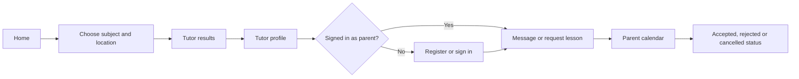
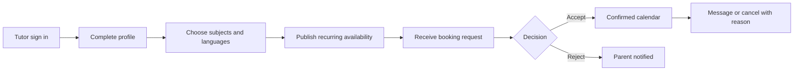

# LessonHarbour Design Evidence

## Evidence status

This is an honest retrospective design record assembled from the evolving prototype, implemented interface and commit history. It documents the layout rules and decisions that guided the finished application. It should not be presented as proof that every diagram existed before coding; early prototype screenshots or dated sketches should be added separately if they are available.

The live implementation is available at [LessonHarbour](https://lessonharbour-live-mvp.qling-wu.chatgpt.site), and the source history records incremental changes to discovery, profiles, scheduling, booking, messaging and bilingual behaviour.

## Design goals

1. Make tutor discovery understandable to a parent in under a minute.
2. Keep the primary journey free of payment or subscription pressure.
3. Support English and Chinese without duplicating page structure.
4. Make scheduling usable on a phone as well as a desktop.
5. Separate public tutor information from private matching data.
6. Prefer clear calendars, status labels and actions over long record lists.

## Visual language

| Element | Design decision | Purpose |
| --- | --- | --- |
| Typography | Serif display headings with simple sans-serif body text | Friendly editorial identity with readable controls |
| Colour | Warm cream surfaces, teal primary actions and coral emphasis | Calm, approachable alternative to corporate marketplace styling |
| Cards | Rounded white cards with light borders and limited shadows | Groups tutor and booking information without heavy decoration |
| Buttons | Clear primary, secondary and destructive states | Makes booking decisions and cancellations unambiguous |
| Bilingual copy | One shared layout with language-aware labels | Prevents English and Chinese experiences drifting apart |
| Responsive grid | Multi-column desktop layouts collapse into one-column mobile flow | Preserves reading order on narrow screens |

## Main user journeys





## Responsive layout evidence

### Home and tutor discovery

```text
DESKTOP
┌──────────────────────────────────────────────────────────────┐
│ Logo        Find tutors   How it works   EN/中文   Sign in   │
├──────────────────────────────┬───────────────────────────────┤
│ Value proposition            │ Featured subject tutor cards  │
│ No subscription              │ [photo] [photo] [photo]       │
│ No hidden fees               │                               │
├──────────────────────────────┴───────────────────────────────┤
│ Subject dropdown        Location dropdown        Search      │
├──────────────────────────────────────────────────────────────┤
│ Subject categories and explanation                           │
└──────────────────────────────────────────────────────────────┘

MOBILE
┌──────────────────────────┐
│ Logo       EN/中文  Menu │
├──────────────────────────┤
│ Value proposition        │
│ No subscription or fees  │
├──────────────────────────┤
│ Subject dropdown         │
│ Location dropdown        │
│ [Search tutors]          │
├──────────────────────────┤
│ Featured tutor card      │
│ Featured tutor card      │
└──────────────────────────┘
```

The desktop version can show discovery and tutor imagery together. Mobile presents the search controls first, uses full-width tap targets and stacks cards in reading order.

### Search results

```text
DESKTOP                                  MOBILE
┌──────────────┬─────────────────────┐   ┌──────────────────────┐
│ Filters      │ Tutor card          │   │ Filters (collapsed)  │
│ Subject      │ Photo, subjects     │   ├──────────────────────┤
│ Level        │ languages, price    │   │ Tutor card           │
│ Location     ├─────────────────────┤   │ Photo and summary    │
│              │ Tutor card          │   ├──────────────────────┤
└──────────────┴─────────────────────┘   │ Tutor card           │
                                       └──────────────────────┘
```

On mobile, filters must not permanently consume horizontal space. Subject group names remain selectable even when the parent does not know the exam level.

### Tutor profile

```text
DESKTOP
┌────────────┬──────────────────────────┬──────────────────────┐
│ Tutor      │ Name, languages, bio     │ Available lessons    │
│ photo      │ subjects, format, price  │ date/time + request  │
│            │ free message composer    │                      │
└────────────┴──────────────────────────┴──────────────────────┘

MOBILE
┌──────────────────────────┐
│ Tutor photo and name     │
│ Languages and subjects   │
│ Biography                │
│ Format and price         │
│ Free message composer    │
│ Available lesson cards   │
└──────────────────────────┘
```

When Chinese is selected, the same profile layout remains stable while an unavailable Chinese biography is translated and cached. The English view always retains the tutor's original wording.

### Authentication and password reset

```text
DESKTOP / MOBILE
┌──────────────────────────┐
│ Sign in                  │
│ Email                    │
│ Password                 │
│ [Sign in]                │
│ Forgot password          │
│ Register instead         │
└──────────────────────────┘
```

Authentication uses one focused column at every width. Password reset is part of the same visual flow so users do not mistake it for a separate service.

### Tutor dashboard

```text
DESKTOP
┌──────────────────────────────────────────────────────────────┐
│ Profile | Availability | Bookings | Messages                 │
├──────────────────────────────────────────────────────────────┤
│ Selected tab content                                         │
│ Profile: subjects, languages, photo, biography               │
│ Availability: date, time, timezone, repeat, calendar         │
│ Bookings: calendar and response actions                      │
└──────────────────────────────────────────────────────────────┘

MOBILE
┌──────────────────────────┐
│ Scrollable tab controls  │
├──────────────────────────┤
│ Selected tab content     │
│ Fields stack vertically  │
│ Full-width actions       │
│ Calendar/list adapts     │
└──────────────────────────┘
```

Subject categories collapse after selection to avoid large blank grid cells. Availability defaults to the current date, preserves the tutor's last entered date after publishing, limits minutes to 00/15/30/45 and offers recurring patterns.

### Parent dashboard

```text
DESKTOP                                  MOBILE
┌──────────────┬─────────────────────┐   ┌──────────────────────┐
│ Student      │ Booking calendar    │   │ Student details      │
│ details      │ selected-day items  │   ├──────────────────────┤
│ subjects     │ cancellation action │   │ Booking calendar     │
│ postcode     │ messages            │   │ Selected-day items   │
└──────────────┴─────────────────────┘   │ Messages             │
                                       └──────────────────────┘
```

The postcode is explained as private matching data. Accepted bookings can be cancelled with a reason, and status changes remain visible to both parties.

## Page coverage matrix

| Page or state | Desktop behaviour | Mobile behaviour | Implemented evidence |
| --- | --- | --- | --- |
| Home | Hero plus tutor cards and inline search | Stacked search followed by cards | Live responsive homepage |
| Tutor results | Filter/search context with multi-card grid | Single-column cards and compact controls | Subject and location discovery |
| Tutor profile | Three-column photo, biography and slots | Ordered single-column content | Public profile, messages and booking |
| Sign in/reset | Centred constrained form | Full-width form with safe margins | Supabase email and recovery flow |
| Tutor profile editor | Grouped form sections | Vertically stacked fields | Subjects, languages, photo and biography |
| Availability | Controls plus calendar/list context | Stacked controls and compact calendar | Recurrence, timezone and 15-minute intervals |
| Tutor bookings | Calendar plus request actions | Calendar then selected booking actions | Accept, reject and cancel |
| Parent dashboard | Details alongside booking calendar | Details then calendar and messages | Required student profile and booking status |

## Accessibility and usability considerations

- Form controls have visible labels rather than placeholder-only meaning.
- Keyboard-compatible native buttons, inputs, selects and textareas are preferred.
- Status is communicated with text, not colour alone.
- Mobile actions use large, full-width targets where space is limited.
- Public photos have a textual initial fallback.
- The bilingual switch changes interface copy without changing navigation structure.
- Error and success messages appear near the active workflow.
- Calendars are supplemented by readable selected-day booking information.

## Design changes made after testing

| Observed problem | Design change |
| --- | --- |
| Subject groups created tall empty columns | Collapse category panels and avoid equal-height grid stretching |
| Parents may know only the broad subject | Make main subject names selectable, with exam levels as optional detail |
| Minute-by-minute availability was slow | Restrict starts to 15-minute intervals |
| Timezones were overwhelming | Present a smaller set of representative UTC offsets |
| Re-entering repeated slots took too long | Add weekly, weekday-only and weekend-only recurrence patterns |
| Availability form reset disrupted batch entry | Preserve the previously chosen date after publishing |
| Manual translation fields were confusing | Remove them and translate automatically only in the Chinese public view |
| Booking lists were difficult to scan | Introduce calendar-oriented booking views |
| URL-only profile photos were unsuitable | Add validated image upload and a fallback avatar |

## Evidence still worth adding

For the strongest assessment evidence, add dated material if it exists:

- Screenshots of the earliest working prototype
- Paper sketches or Figma layouts created before implementation
- Before-and-after screenshots of the subject dropdown and availability form
- Desktop and mobile screenshots from the same release
- Short captions linking each change to user feedback or a discovered bug

These additions would prove chronology. The current document proves the final responsive design intent and records the changes, but it does not invent missing pre-coding artefacts.
