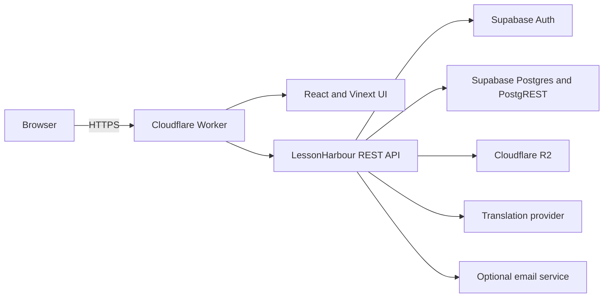

# LessonHarbour Project Plan and Architecture Decisions

## Purpose

LessonHarbour is an open-source bilingual service that helps families discover tutors, contact them without a subscription, and request lessons without an intermediary booking fee. The initial audience is overseas Chinese families, especially those in Southern England seeking support for 7+, 11+, 13+, GCSE and A-Level study, alongside music, arts, coding and mentoring.

The project was deliberately reduced to a stable booking MVP before adding payments, promoted listings, reviews or built-in video teaching. This document records the current plan, the reasons behind major technical choices, the risks, and the changes made during development.

## Users and core needs

### Parent or student

- Search by subject, level and location.
- Compare tutor experience, languages, price and lesson format.
- Contact a tutor without paying a subscription.
- Request, view and cancel lessons.
- Keep private matching information, such as postcode, out of public profiles.

### Tutor

- Publish a bilingual-friendly profile with subjects, languages and a photo.
- Add recurring availability without entering every lesson separately.
- Receive and respond to booking requests.
- Message families and give a cancellation reason when plans change.
- Subscribe to confirmed lesson information through a calendar feed.

## Route A brief

**Idea:** a free and open tutor discovery and booking platform with optional future paid promotion rather than compulsory commission or subscriptions.

**Users:** tutors, parents and students, initially focused on overseas Chinese families in the UK.

**Main features:** tutor discovery, role-based accounts, profiles, messages, recurring availability, booking requests, calendar views, cancellation workflows and bilingual presentation.

**APIs and services:** LessonHarbour REST API, Supabase Auth and PostgREST, Cloudflare R2, optional Cloudflare transactional email, and DeepL or MyMemory for published-biography translation.

## MVP scope

### Included in the current release

- Email registration, login, logout and password reset
- Parent/student and tutor roles
- Required student matching information
- Multi-subject tutor profiles and photo upload
- Search and public tutor profiles
- English and Chinese interfaces
- Automatic Chinese biography translation on demand
- Free direct messaging
- Recurring availability in 15-minute increments
- Timezone-aware date handling
- Booking request, accept, reject and cancel workflows
- Calendar displays and iCalendar subscription feeds
- Supabase persistence, REST endpoints, tests and CI

### Deferred until the core journey is stable

- Built-in video classroom
- Payments, refunds and disputes
- Promoted tutor ranking and VIP priority booking
- Ratings and reviews
- Tutor identity, qualification and safeguarding verification
- Native iOS and Android applications
- Advanced distance search and map display

Deferring these features keeps the assessed project focused on a complete, testable user journey rather than many incomplete integrations.

## Architecture

The detailed data flow and security boundary are documented in [ARCHITECTURE.md](ARCHITECTURE.md). Endpoint-level behaviour is documented in [API.md](API.md).

## Technical choices and reasons

| Choice | Reason | Trade-off |
| --- | --- | --- |
| React and TypeScript | Component reuse, type checking and a strong ecosystem for interactive dashboards | More build complexity than static HTML |
| Vinext | Next-compatible routing and server APIs while targeting Cloudflare Workers | Less mature than standard Next.js hosting |
| Cloudflare Workers | Public HTTPS hosting close to users, server-side API execution and security headers | Worker runtime differs from a traditional Node server |
| Supabase Postgres | Managed relational database, authentication and REST access; booking relationships fit a relational model | Requires careful secret-key handling and database policies |
| Server-side PostgREST access | Keeps the database secret out of the browser and centralises role checks | The application server must enforce every ownership rule correctly |
| R2 for profile photos | Keeps uploaded files outside the database and supports validated delivery | Requires a separate storage binding and upload controls |
| REST API | Clear boundary between UI and data operations; easy to document and test | More endpoints to maintain than direct browser database calls |
| UTC storage plus IANA timezones | Prevents ambiguity and handles daylight-saving changes | Conversion rules require dedicated tests |
| MyMemory fallback | Provides no-cost translation when DeepL is not configured | Published biography text is sent to a third party and quality can vary |
| External meeting links first | Delivers online lesson coordination without building video infrastructure | The actual classroom experience remains outside LessonHarbour |

## Data model

| Entity | Purpose | Important relationships |
| --- | --- | --- |
| `users` | Application identity and role | One account is a student/parent or tutor |
| `student_profiles` | Student name, private postcode and requested subjects | Belongs to one student account |
| `tutor_profiles` | Public teaching information and private matching fields | Belongs to one tutor account |
| `availability_slots` | Future lesson windows | Belongs to one tutor |
| `bookings` | Request and response state | Connects one student, tutor and slot |
| `messages` | Direct communication | Connects sender and recipient accounts |
| `rate_limits` | Abuse-resistant operation counters | Scoped to an identity or protected resource |

## API groups

- Authentication and account: `/api/auth`, `/api/account`, `/api/me`
- Tutor discovery and profiles: `/api/tutors`, `/api/tutor-profile`
- Student matching profile: `/api/student-profile`
- Availability: `/api/availability`
- Booking lifecycle: `/api/bookings`
- Messaging: `/api/messages`
- Photos: `/api/profile-photo`
- Calendar sync: `/api/calendar-feed`
- Translation: `/api/translate`, `/api/tutors/:id/translation`
- Location support: `/api/timezone`

## Delivery stages

1. Define the reduced MVP and user roles.
2. Build tutor discovery and a working booking journey.
3. Add persistent accounts, profiles and availability.
4. Migrate persistence and email authentication to Supabase.
5. Add messaging, calendar views and cancellation workflows.
6. Improve bilingual presentation and on-demand translation.
7. Add automated tests, security controls, documentation and GitHub CI.
8. Stabilise and collect feedback before expanding scope.

## Risks and mitigations

| Risk | Impact | Mitigation | Remaining work |
| --- | --- | --- | --- |
| Overly broad marketplace scope | Core booking journey remains unfinished | Defer payments, video, reviews and native apps | Review scope before every new feature |
| Secret leakage | Database or provider compromise | Server-only environment variables, `.gitignore`, `.env.example`, repository scans | Rotate immediately if a secret is ever exposed |
| Cross-account data changes | Privacy and integrity failure | Server-side roles, ownership filters and same-origin checks | Expand automated authorization tests |
| Double booking | Two students believe they own one slot | Database uniqueness plus booking-state validation | Add concurrency-focused integration testing |
| Private postcode exposure | Family or tutor privacy harm | Return postcode only to its owner; public API uses it only for ranking | Document retention and deletion policy |
| Translation privacy or quality | Published text reaches a third party or is mistranslated | Translate published biography only, disclose provider, cache results | Add tutor correction/reporting workflow |
| Timezone and daylight-saving errors | Lessons display at the wrong time | Store UTC, use IANA timezones and test DST behaviour | Test more international zones |
| Unverified tutors | Safeguarding and trust risk | State MVP limitation and avoid claiming verification | Verification is required before wider launch |
| External email failure | Tutor misses a request | In-product status remains authoritative; booking writes do not depend on email | Add delivery monitoring and retry strategy |
| Hosting source drift | GitHub and deployed site differ | CI checks GitHub; document the current manual publication process | Connect one canonical repository to automated deployment |

## Change record

| Original direction | Final decision | Why it changed |
| --- | --- | --- |
| General UK tutor marketplace | Initial focus on overseas Chinese families in Southern England | Clearer audience and bilingual value proposition |
| Built-in online classroom | External meeting coordination and calendar support first | Video infrastructure was too large for the final-project timeframe |
| ChatGPT-only identity | Supabase email registration and password reset | The service must be usable by any family or tutor |
| Earlier hosted data approach | Supabase Postgres and PostgREST | Easier persistent relational data and authentication integration |
| Manually entered translation fields | Automatic Chinese translation when the visitor switches language | Reduced tutor effort and removed a confusing broken control |
| Free-form minute selection | 15-minute intervals with recurring weekday/weekend options | Faster tutor setup and more realistic scheduling |
| Flat subject field | Multi-select subject categories and exam levels | Tutors may teach several subjects and parents may search broadly |
| List-only lesson display | Calendar-oriented views plus calendar feed | Makes future lessons easier to understand and reuse |

## Definition of done for the assessed MVP

- A new user can register with email and recover a forgotten password.
- A tutor can create a profile, upload a photo and publish availability.
- A parent can complete matching details, find a tutor, send a message and request a lesson.
- The tutor can accept, reject or cancel, and both roles can see the result.
- Private fields are not present in public tutor responses.
- Tests, lint and production build pass in GitHub Actions.
- The live site, source code, architecture, API, security and design evidence are accessible for assessment.

## Success measures

For the final project, success means a complete and explainable journey rather than marketplace growth. Evidence includes successful CI, a reliable live demo, no exposed secrets, clear authorization boundaries, responsive page layouts and the ability to explain why the architecture changed.
